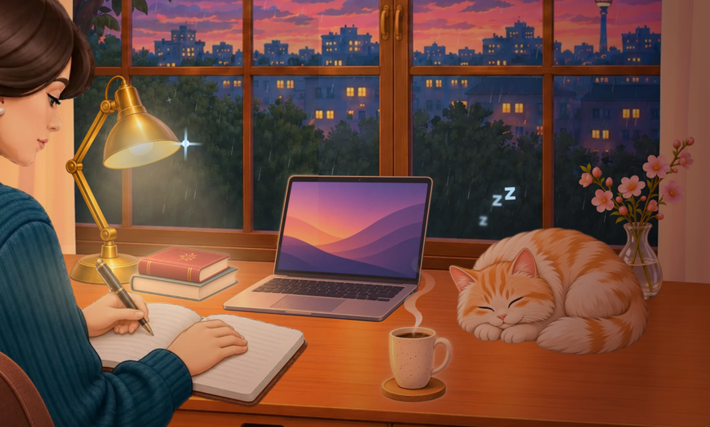
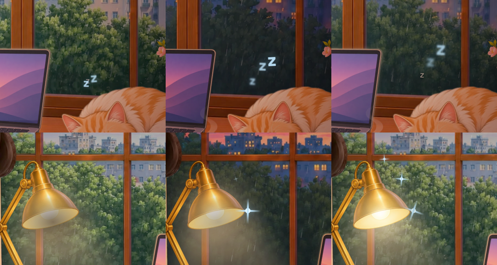

# Glimmer tells: moonlight hints

Mock: `docs/design-explorations/glimmer-mock.html`. Open it while the dev server runs on :5173. It plays the real room in a frame, with the hints looping on top.

**Problem.** Today a glimmer's tell is too faint to notice. The cat's cream z's are about 12px and fade into the pale window. The lamp shows three hairline wiggles for 1.3s. Each glimmer shows itself only about once every 30s.

**Goal.** Hints, not instructions. Nothing tells the visitor what to do. A glimmer only looks a little alive and a little magic, so they want to touch it. Glimmers get a colour of their own, so they never get mixed up with the sections. They're a bit bigger than today, and they move at the room's own calm pace.

---

## The glimmer rule

This replaces the "Glimmers" paragraph in DESIGN.md and the header of `src/scene/glimmers.ts`.

> **Glimmers** are objects that answer in place (the cat, the lamp). They have no halo and no label. Each one has a **hint** instead: a small sign of life that makes a visitor curious, never an instruction (no hands, arrows, rings or words like "click").
>
> 1. **Moonlight is the glimmers' colour.** Glimmers speak in one soft moonlight blue (`--moon: oklch(0.9 0.05 235)`, with a faint blue bloom) that nothing else in the room uses. Sections breathe amber and the record player glows vermilion, so the colour alone says "this is a different kind of thing". The bloom is a soft edge on the hint's own small marks, never a halo on the object.
> 2. **Each speaks in its own nature.** A hint is something the object would do anyway: the sleeping cat breathes out z's; the lamp's bulb catches, as if a switch had been touched, and glints run round its brass rim.
> 3. **The room's pace and curves.** Hints use the room's own motion: they arrive out of a 3px blur like her greeting, drift on `--ease-drift`, breathe on `--ease-sine`, and are never held still and never snap. Each hint lasts about 3s.
> 4. **Bolder, not bigger; the same weight.** Hints are noticed through a firm stroke (bold letters, crisp glints), not through size. Each covers about the same area, about 4cqi (≈55px on a laptop), on the window side of its object, clear of her face and the masthead.
> 5. **Looped while unfound, one at a time.** A hint repeats every 9s while its glimmer is unfound. The two run half a cycle apart, so only one moves at a time: the cat, then the lamp. The first one comes after the room's first look and after her greeting has floated away. The greeting's timing never moves.
> 6. **Quiet when it should be.** A hint pauses while a page is open, the room is paused, the tab is hidden or something is being pointed at. With reduced motion, the hint appears still, softly, without moving.
> 7. **Found is for good.** Hovering, focusing or tapping a glimmer finds it, and this is remembered in the browser. Its hint stops. The cat goes back to its occasional cream dreams and the lamp to its hover tease. When all are found, the room is quiet.
>
> A new glimmer needs an entry in `GLIMMERS` and one moonlight hint in its own nature.

---

## The two hints

### Cat: three z's in moonlight
- Three lowercase z's in bold, upright Geist (700, the face of the room's speech labels; no italic), each a little larger than the last (≈18 → 23 → 29px on a laptop). Their weight makes them noticeable, not their size. They come 0.7s apart, each arriving out of a slight blur. They drift up and to the right of its head on a gentle curve, tipping a little, and fade as they float. That's the pet splash's motion, slower.
- A new puff (`cat__puff--tell`). The cat's own dreams and the pet splash keep their cream colour, so moonlight always means "you haven't met me yet".

### Lamp: the bulb catches, glints run round the rim
- The bulb flicks: down and back, then a softer down and back (about 1s). It looks like a loose switch, and it's the hint that the lamp can be switched. It uses the bulb's own light (`LampLiquid` / `lamp-light`), not a layer on top.
- Then three four-point glints twinkle up the brass, from the rim's right edge to the top of the shade, 0.3s apart. Each turns slightly as it fades, the largest at the rim (≈40px). They're moonlight on brass.
- This is a new `glint()` on `LampSplash`, next to `tease()` and `burst()`. The flick is a new `data-flick` state on the lamp's light.

---

## Changes, file by file

| File | Change |
|---|---|
| `src/scene/glimmers.ts` | New header (the rule above). Replace `TELL_EVERY_MS` / `nextTell` with `TELL_CYCLE_MS` (9000) and `tellOffset(id)` (half a cycle per glimmer). Keep `findGlimmer` / `unfoundGlimmers`. |
| `src/components/HeroScene/useGlimmerTells.ts` | A loop per unfound glimmer that bumps its counter every cycle, and skips a cycle (doesn't queue it) while busy or hidden. The first cycle waits for the first look and the greeting. It returns the same `Record<GlimmerId, number>`. |
| `CatOverlay.tsx` | `tell` plays `makeTell()` (three moonlight z's) without resetting the dream timer. |
| `lamp/LampSplash.tsx` | Add `glint()`: three twinkles up the rim. |
| `LampLiquid.tsx` / lamp light | Add a `flick` prop: the bulb's two dips, on the bulb's own light. |
| `HeroScene.tsx` | The lamp's tell sets the flick, then calls `glint()`. |
| `HeroScene.css` | Add the `--moon` tokens, `.cat__puff--tell`, `.lamp-splash__glint` and the flick keyframes, plus the reduced-motion still versions. |
| `DESIGN.md` | Replace the Glimmers paragraph with the rule above. Add moonlight to the palette as the glimmers' colour, next to "No purple, blue or neon". |
| `src/__tests__/glimmers.test.ts` | Tests for the cycle, the half-cycle offset, stopping when found, and staying silent when all are found. |

## Checks
- Preview at 1440×900, on a phone (375px), and at dawn, midday and night: are both hints noticeable, with the same weight and no instruction?
- Hovering the cat stops its hint for good (after a reload too).
- Reduced motion: the hints sit still.
- No new large GPU layers: the marks are small, and nothing big gets a `filter`.
- The greeting still floats at 4.6s / 550 / 4700, untouched.
